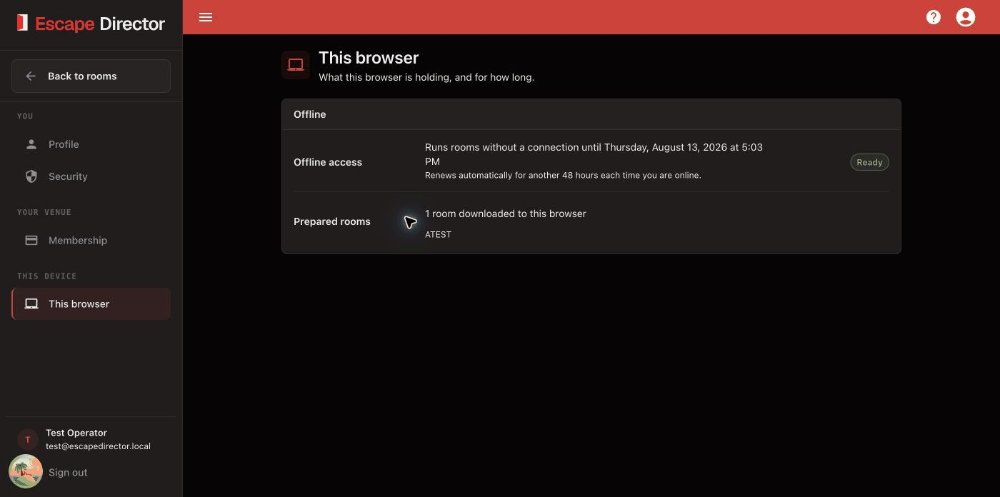

# Use Account Settings

Account Settings is a separate workspace with sections for **Profile**, **Security**, **Membership**, **Beta features**, and **This browser**. Use **Back to...** to return to the application page you came from.

## Open Account Settings

Select **Account Settings** in the application navigation or account menu, then choose the section you need.

<figure><figcaption>
This browser reports its own offline access and prepared Rooms; another browser can have different readiness.
</figcaption></figure>

## Update your profile

Open **Profile** to update the account name, or add an optional business name and phone number. Clear an optional field to remove it. The email address is shown for reference; contact support when it must change. Select **Save** when the unsaved-changes bar appears.

## Review membership and billing

Open **Membership** to check status, plan, and the current period or cancellation date. Select **Manage billing** to open Stripe's billing portal for supported subscription and payment-method actions. Use **Update card** when the status requires payment action.

**Media storage** shows how much of your 25 GB media storage your Rooms and Leaderboards use. See [Storage limits](../build-your-rooms/manage-room-media.md#storage-limits).


Review the effective date shown by Stripe before confirming a cancellation or plan change.


To add or remove a site, see [Manage Locations](manage-locations.md).

## Change your password

Open **Security**. Escape Director shows the sign-in method first. Accounts that sign in only through a linked provider do not have an Escape Director password form.

1. Enter the current password.
2. Enter and confirm the new password.
3. Select **Change password** once.
4. Store the new password securely.

Use **Forgot Password** from the sign-in page when the current password is unavailable.


Changing the password signs out every other browser and tablet immediately, including a Room Station. Change it between games, not during one.


## Delete your account

Deleting your account removes it and everything in it for good. Only do this when you are sure: no one can bring it back.

1. Open **Security** and select **Delete account**.
2. Read the list of what will be deleted: your Rooms with their Puzzles, Clues and Automations, game records and Analytics, Locations, Game Master profiles, Leaderboards, and uploaded files.
3. Enter your password. If you sign in with Google, select **Sign in with Google** first; you come back to the same dialog.
4. Type `DELETE` and select **Delete account**.

When it is done, you land on the Escape Director home page and can no longer sign in. All media in your Rooms, such as videos, sounds and images, is deleted from our storage too. Room Stations clear the room files they saved for offline play within 2 days.


Your membership ends right away and you are not charged again. The rest of the current billing period is not refunded. Every computer signed in to the account is signed out, including Room Stations, so delete the account when no games are running.


Stripe keeps your past invoices and payments because tax law requires it. To stop paying but keep your Rooms and history, cancel in **Membership → Manage billing** instead.

## Try beta features

Open **Beta features** to try new features before everyone else.

- Turn a feature on or off with its switch. The change applies to your whole account.
- Select **Learn more** when a feature has it to read how the feature works.
- Turning a feature off hides it again. Anything you made with it stays saved.

When the list is empty, there are no beta features to try right now.

## Check this browser

Open **This browser** to see:

- whether offline access is **Ready** and when it expires;
- how many Rooms are downloaded to this browser; and
- which Rooms are currently prepared.

This state belongs to the current browser profile. It does not prove that another Room Station is ready.

## Check notifications

Select the bell at the top of the app to open **Notifications**. A dot on the bell means something is unread.

Notifications include new product updates and a reminder when your free trial ends within 7 days. Select a notification to open it. Select **Mark as read** or **Mark all read** to clear the dot.

## Sign out

Select **Sign out** only after active Room Sessions and pending saves are complete. Profile, security, and billing changes require a connection; prepared Rooms may still run offline while their displayed access remains valid.

## You're ready when...

The intended profile, membership, security, or browser-readiness state is confirmed and you can return to the application safely.

## Get help

For a membership state that does not match Stripe, or an account you cannot access, [contact support](../help/README.md).
