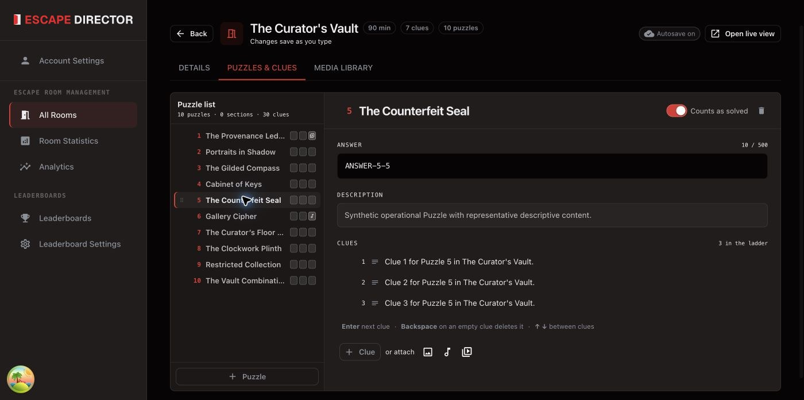

# Add Puzzles and Clues

Puzzles are the challenges in a Room; each has ordered Clues the Game Master can
send. Edit them in **All Rooms → Edit → Puzzles & clues**, or from the Room
Dashboard during a game.

<figure><figcaption>
The Puzzle rail stays visible while you edit one Puzzle and its Clue ladder.
</figcaption></figure>

## Add a Puzzle

1. Select **Puzzle** at the bottom of the Puzzle list and enter a short name.
   To group Clues without adding a Puzzle to solve, select **Section** instead;
   it doesn't count toward completed Puzzles. To switch later, use **Convert to
   Section** or **Convert to Puzzle** in **Puzzle options**.
2. Add the answer and a short internal description if they help the Game Master.
3. Add Clues in order, from a light nudge to direct help. Use the attachment
   actions beside **Clue** for an image, audio, or video from the Media library.
4. Select **Apply changes**. Edits aren't saved until you do.

Order Puzzles the way players usually solve them. Write Clues for players;
keep staff notes in the Puzzle description.

## Edit Puzzles and Clues from the Room Dashboard

You can add and edit Puzzles and Clues from the Room Dashboard, even during a game.

- **Puzzle:** select **+** at the top of the Puzzles list, or **Edit Puzzles**
  and then **Edit Puzzle** from a Puzzle's actions. Turn **Can be marked
  complete** off for a Clue Section.
- **Clue:** select the Puzzle, then **+** at the top of the Clues list. Choose
  **Text**, **Image**, **Audio**, or **Video**, type the text or choose the file
  from **Room media**, and select **Create Clue**. To edit or reorder Clues,
  select **Edit Clues**.

How it differs from the editor:

- A change to **Can be marked complete** during a game applies to the next game.
- You can delete a Puzzle only after deleting its Clues. In the editor, deleting
  a Puzzle also deletes its Clues.
- A media Clue can only use a file already in the Media library. Upload new files
  in [Manage Room Media](manage-room-media.md).
- You can't add or edit Puzzles or Clues while the Room Dashboard is offline.


Deleting a Puzzle deletes its Clues; past Room Sessions stay the same. Deleting a
Media library file also deletes every Clue that uses it. Review the confirmation
before continuing.


## Next

[Manage Room Media](manage-room-media.md)
