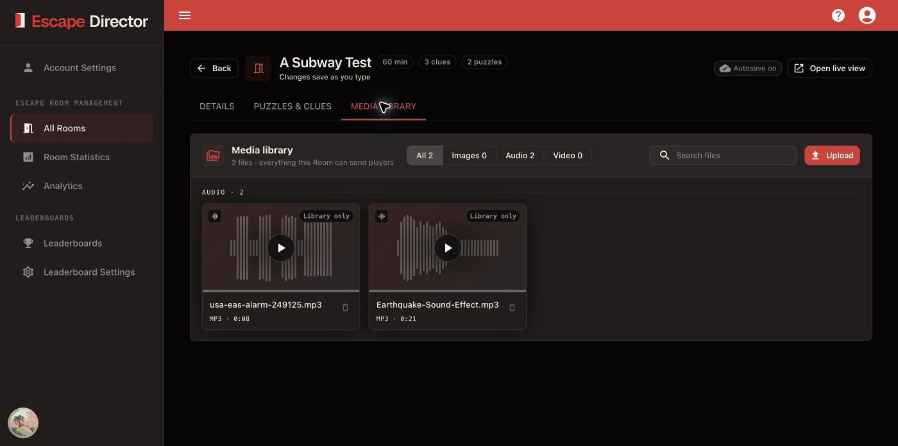

# Manage Room Media

The Media library holds a Room's images, audio, and video for Clues, Live View,
and sending during a game. Open it in **All Rooms → Edit → Media library**.

## Upload a file

Select **Upload**, choose an image, audio, or video file, and wait for the upload
to finish.

<figure><figcaption>
The consolidated Media library keeps every Room file searchable and previews audio and video before live use.
</figcaption></figure>

Use recognizable filenames and avoid near-duplicate uploads. Play audio and
video from its card to check it before a game.

## Storage limits

All your Rooms and Leaderboards share 25 GB of media storage. Each file can be up
to 5 GB.

- See how much you've used in **Account Settings → Membership → Media storage**.
  It warns you when storage is nearly full.
- If an upload doesn't fit, Escape Director tells you how much space it needs and
  how much is free. Delete media you no longer use, then try again.
- Deleting a file or a Room frees the space its media used.

## Where media is used

- **Live View:** choose the alert tone, soundtrack, background image or video,
  and intro video brief in the **Details** tab. See
  [Configure Live View](configure-live-view.md).
- **Clues:** attach a file in the Puzzle editor. See
  [Add Puzzles and Clues](add-puzzles-and-clues.md).

Each file's usage label shows how many Room settings or Clues use it. **Library
only** means nothing points to it, but Game Masters can still send it during a
game. To replace a file, change the setting or Clue to use the new one.

## Delete a file

Review every listed use in the confirmation before deleting.


Deleting a file is permanent. Escape Director also removes it from Room screen
settings and deletes any image, audio, or video Clues named in the confirmation.
Past Room Sessions stay the same.


## Next

[Configure Room Automations](configure-room-automations.md) when the Room needs repeatable sequences. Otherwise, go to [Prepare for a Shift](../prepare-for-a-shift/README.md).
