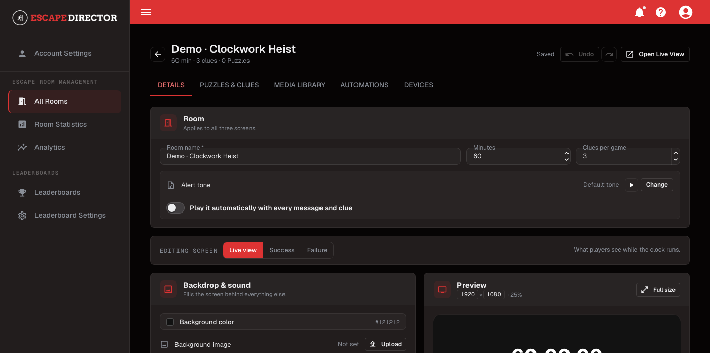

# Create Your First Room

Use this guide to create the Room shell that you will configure and test.

## Create the Room

1. Open **All Rooms**.
2. Select **Create Room**.
3. Enter a Room name your staff will recognize.
4. Set the starting time in minutes.
5. Set **Clues per game**.
6. Select **Create Room**.

<figure><figcaption>
After creation, the Details tab keeps Room defaults and all three player-facing screen configurations together.
</figcaption></figure>


The Game Master can adjust time and reported Clues during a live Room Session. These values establish the normal starting state.


## Understand saving in the editor

After the Room is created, changes on **Details** save automatically. Wait for the autosave status to return to **Autosave on** before leaving the page. Puzzle changes use their own **Apply changes** action.

## Check the Room shell

After saving, confirm that the Room appears on **All Rooms** and that **Edit** opens the Room editor.

## Delete a Room


Deleting a Room is permanent. It deletes the Room's Puzzles, Clues, media, Automations, and every game played in it. Its games leave Room Statistics, Analytics, and Leaderboards. Edit the Room instead unless you want all of this gone.


You need a connection to delete a Room. If the Room Station still has finished games waiting to sync, reconnect and let them sync first.

1. Open **All Rooms**.
2. Select **⋮** (Room actions) on the Room, then **Delete room**.
3. Type the Room name to confirm, then select **Delete room**.

## You're ready when...

The correct Room name, starting time, and Clues per game appear in the editor, and the autosave status is clear.

## Next

[Build Your Rooms](../build-your-rooms/README.md)
