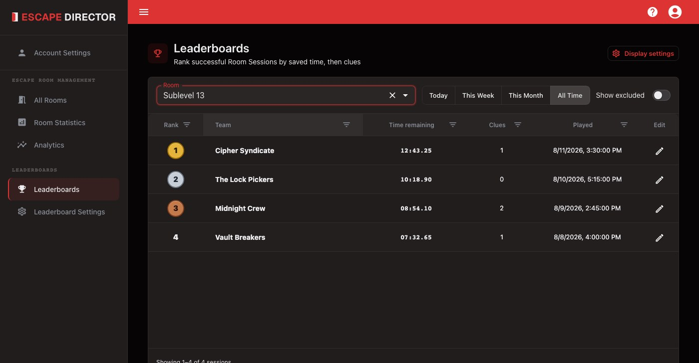
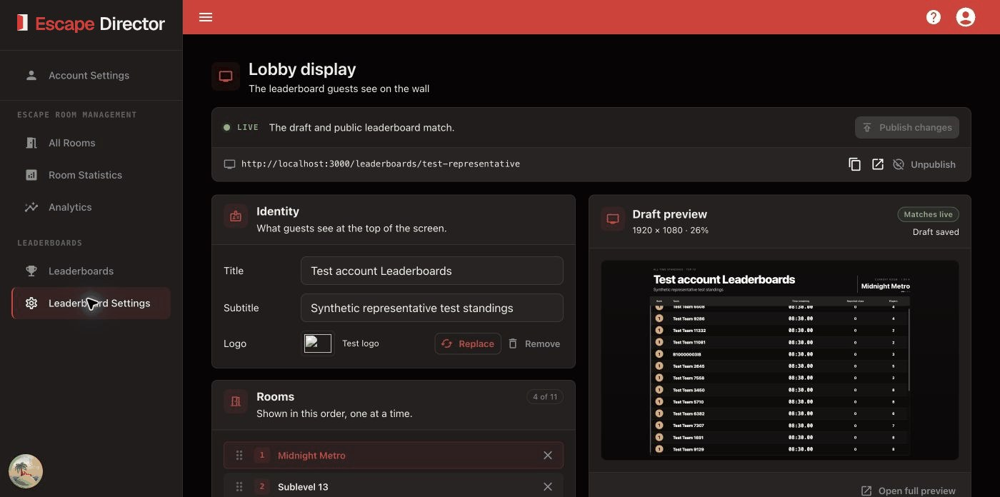

# Manage Leaderboards

Leaderboards rank a Room's successful Room Sessions and publish them to a lobby
display. Open **Leaderboards** in the application navigation.

## Review rankings

Choose a Room and a period: **Today**, **This Week**, **This Month**, or **All
Time**.

<figure><figcaption>
Leaderboards rank included successful Room Sessions within the selected period.
</figcaption></figure>

Teams rank by time remaining. If the Room collects reported Clues, fewer Clues
break a tie; otherwise equal times stay tied and there is no Clues column. Failed
Room Sessions aren't ranked.

## Correct a leaderboard entry

Use a row's edit action to correct the public team name or select **Exclude from
public leaderboards**. Keep private notes in Room Statistics, not in the team
name. **Show excluded** lists entries you've removed from the public ranking.

## Configure the lobby display

Select **Display settings** to set up the public lobby display.

<figure><figcaption>
The draft preview stays beside the settings while the public leaderboard remains on the last published version.
</figcaption></figure>

1. **Identity:** set the title, optional subtitle, and logo.
2. **Rooms:** add Rooms and drag them into order.
3. **Standings:** choose how many teams to show and the ranking period. Rank,
   team, time, and Clues always show; turn on **Players** and **Date** in the
   table preview.
4. **Appearance:** choose the default background, any per-Room backgrounds, and
   the color used when there is no image.
5. Check the **Draft preview**. To match your lobby screen, type its width and
   height in the preview header, such as 1080 × 1920 for a screen on its side.
   This only changes the preview.

Changes save to a draft. The public leaderboard changes only when you select
**Publish** or **Publish changes**; **Reset to published** discards the draft.
After publishing, open **View live** on the lobby display to check it.

## Next

[Prepare for a Shift](../prepare-for-a-shift/README.md) before the next group arrives.
