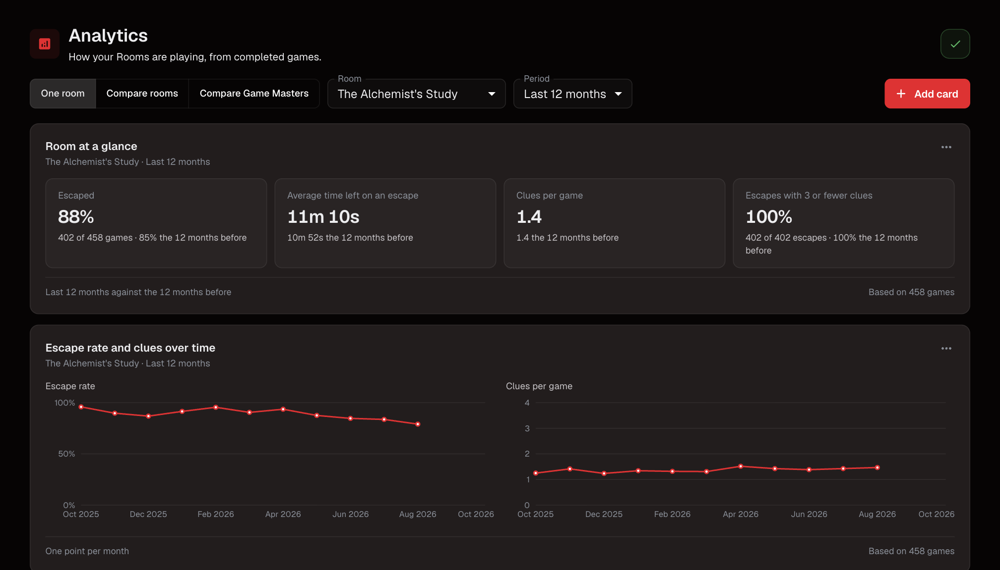
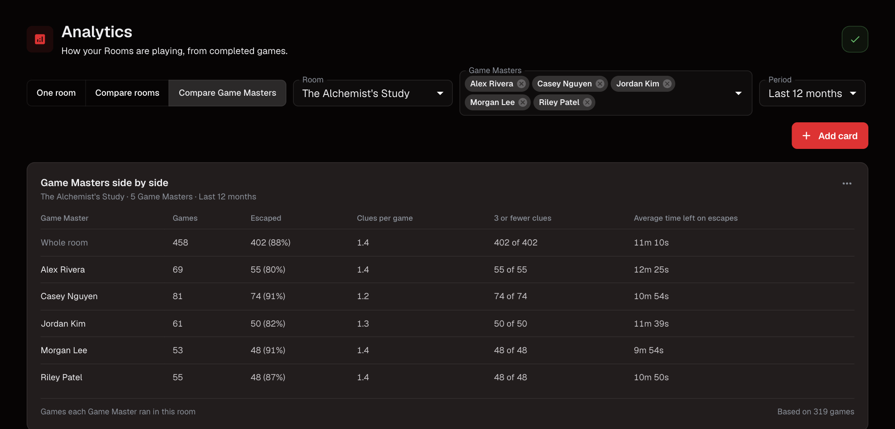
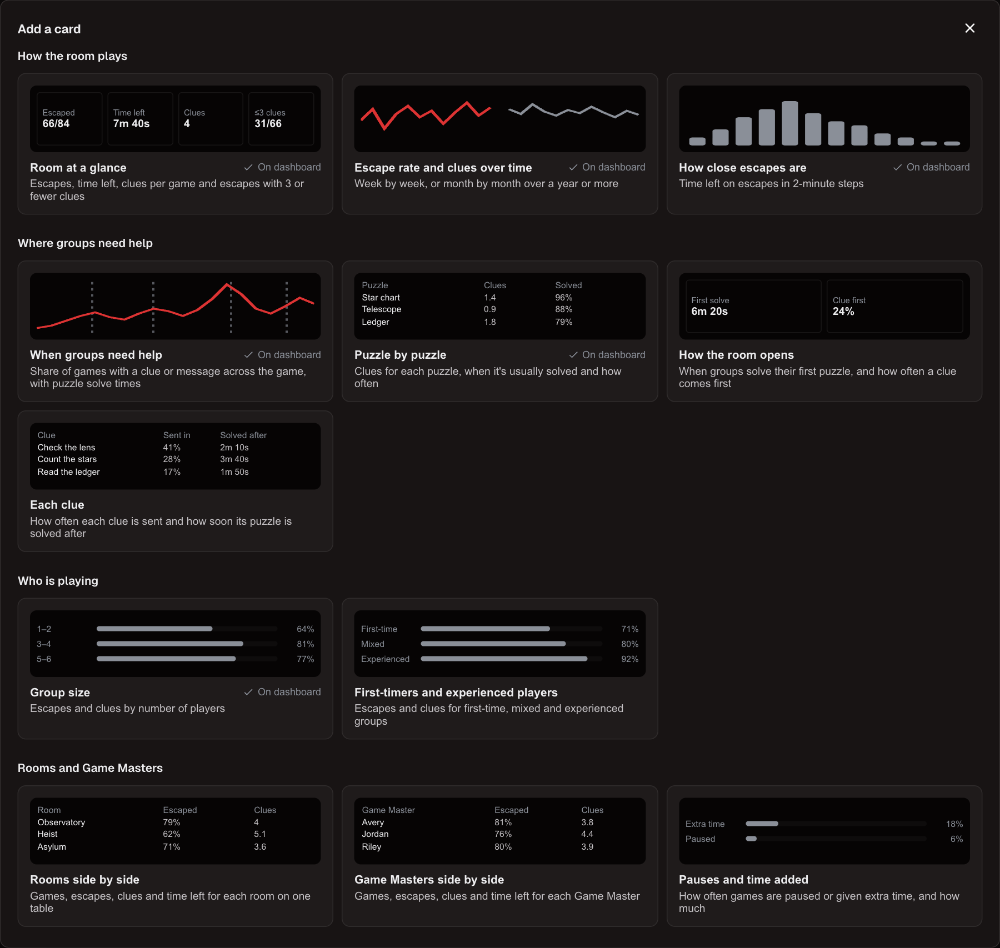
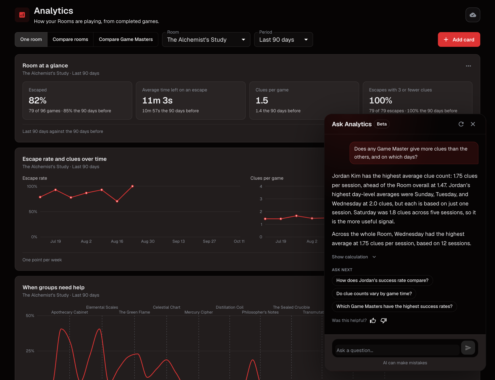

# Use Analytics

Analytics shows how your Rooms play across completed Room Sessions that aren't
excluded. Open it from **Analytics** in the application navigation.

## Choose what to look at

At the top of the page, choose a view, then the Room, Rooms or Game Masters and a
period such as **Last 90 days** or **All time**. These choices apply to every card.

| View | Shows |
| --- | --- |
| **One room** | One Room in detail. |
| **Compare rooms** | Two to five Rooms side by side. |
| **Compare Game Masters** | Two to five Game Masters within one Room. Everyone on the account can see it. |

<figure><figcaption>
The switch, Room and period at the top apply to every card on the page.
</figcaption></figure>

Each card's footer says what was counted and how many games the figures are
based on. A Room or Game Master with fewer than 10 games is marked in comparison
tables, not hidden.

<figure><figcaption>
Compare Game Masters keeps one Room and adds a row for each Game Master.
</figcaption></figure>

## The cards

| Card | Shows |
| --- | --- |
| **Room at a glance** | Games, escape rate, clues, and time left. |
| **Escape rate and clues over time** | One point per week, or per month over 12 months or more. Weeks without completed games are gaps. |
| **When groups need help** | The share of games with a clue or message at each point of the game, with lines for when each Puzzle is usually solved. |
| **How close escapes are** | Time left on escapes, in 2-minute steps. |
| **Group size** | Escapes and clues by number of players. |
| **Puzzle by puzzle** | Clues for each Puzzle and when it is usually solved. |

**When groups need help** and **Puzzle by puzzle** show one Room at a time,
because each Room has its own Puzzles and length. When comparing Rooms, select
**Show one room** on these cards. For older games saved before Escape Director
recorded game clock times, **When groups need help** uses estimated times; its
footer says how many.

## Add, arrange, and remove cards

Select **Add card** to preview and add a card. Extra cards include **Each
clue**, **How the room opens**, **Pauses and time added**, **First-timers and
experienced players**, **Rooms side by side**, and **Game Masters side by side**.

<figure><figcaption>
Add card shows a preview of each card and marks the ones already on the page.
</figcaption></figure>

A card's menu also has:

- **Move up** and **Move down** to change its place;
- **Remove from dashboard** (select **Undo** if you removed the wrong one);
- **Rooms, Game Masters and period** to give the card its own choices instead of
  the page's;
- **About this card** to see exactly what it counts; and
- **Download CSV** to download its figures.

## Set an escape-rate target

**Room at a glance**, **Escape rate and clues over time**, and **Rooms side by
side** can show a target beside the escape rate. In the card's menu, choose
**Escape-rate target**, enter a whole number from 1 to 100 for each Room, and
select **Save**. Each Room has one target, shared by everyone on the account.

## Ask Analytics

Select **Ask Analytics** to ask about your Rooms in plain language. Start with a
suggested review or type your own question.


Ask Analytics is in beta. It shows only on accounts that are part of the beta
and have a paid membership, not during the free trial. Each month has a usage
limit; when an account reaches it, the button is hidden until the next month.


<figure><figcaption>
Ask Analytics answers beside the page and shows the numbers behind each answer.
</figcaption></figure>

Ask Analytics can split a figure by day of the week, weekday or weekend, time of
day, or Game Master, and follow it week by week or month by month. For example,
ask which days a Game Master who often adds time usually works. It shows the
numbers behind each answer, and says so when your data can't answer a question.

## Next

[Manage Leaderboards](manage-leaderboards.md)
