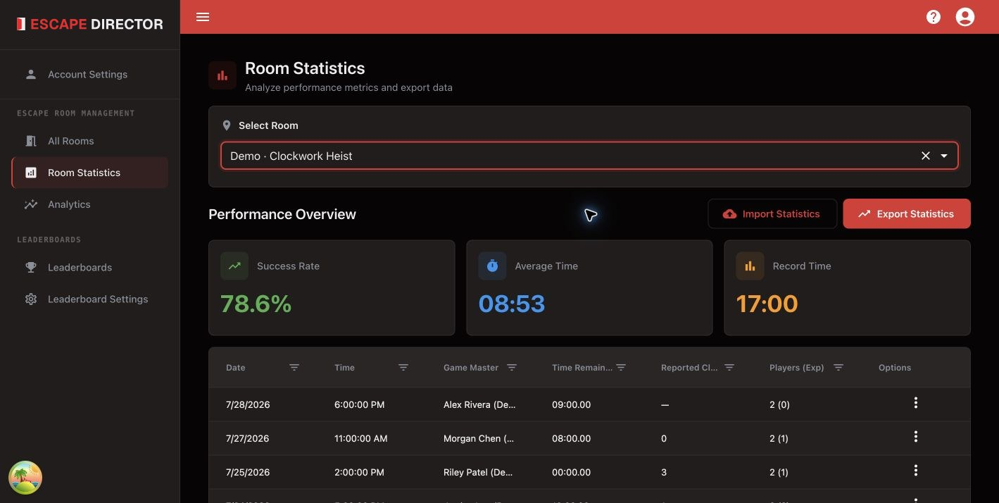

# View Room Statistics

Room Statistics shows the details of each saved Room Session for one Room. Open
**Room Statistics** in the application navigation and choose a Room.

<figure><figcaption><p>Room Statistics combines summary values with the underlying Session list.</p></figcaption></figure>

The overview shows the Room's success rate, average saved time remaining, and
record time. The table lists each Room Session's date, Game Master, time
remaining, reported Clues (when the Room collects them), and player counts.

## Edit a Room Session

Use a row's actions to edit the team name, Game Master, reported Clues, player
counts, notes, or public-leaderboard exclusion. The date, result, Room, and time
remaining can't be changed.


Delete a Room Session only when it should no longer exist. To keep it for review
but out of public rankings, use **Exclude from public leaderboards** instead.


## Review a Room Session

Choose **View report** from a row's actions to see how the game went: the
result, time left, Clues, Puzzles solved, and any pauses or time changes. The
chart shows time left on the clock across the game, with what was sent and every
clock change underneath. Hover over or tap a mark to see what it was. Sessions
imported from a CSV file have no timeline, so their report shows the totals
only.

Switch to **Session Log** for every event in order. Its filter starts with
everything shown; the session start, time adjustments, and outcome are always
shown. An older record may keep a Game Master's earlier name after the profile
is renamed or archived.

**View notes** shows the notes saved with the session. Choose **Edit notes** to
change them.

## Import or export CSV

- **Export Statistics** downloads the Room's Room Sessions as a CSV file.
- **Import Statistics** checks the file before adding its Room Sessions to the
  selected Room. If anything needs fixing, nothing is imported and Escape
  Director tells you which row and column to correct.

Before importing:

- Create a Game Master Profile for every Game Master named in the file. Names
  match regardless of capitalization.
- Keep each file to one Room.
- Keep a copy of the original before you edit it.

## Statistics CSV format

Start from an export or from the [template CSV](../.gitbook/assets/room-statistics-template.csv). The first row must contain these headers, spelled exactly and in this order. Each following row is one Room Session.

| Column | Required | Allowed values |
| --- | --- | --- |
| Played At | Yes | The session's date and time, like `2026-07-19T18:00:00.000Z`. |
| Result | Yes | `Success` or `Failure`. |
| Time Remaining | Yes | Minutes, seconds and hundredths as `mm:ss.cc`, like `12:34.56`. Use `00:00.00` when no time remained. |
| Game Master | Yes | The name of one of your Game Master Profiles. |
| Team Name | No | Any text. |
| Clues Used | No | A whole number, like `2`. Leave it blank when the number is unknown. |
| Total Players | Yes | A whole number, like `5`. |
| Experienced Players | No | A whole number, like `3`. A blank value counts as `0`. |
| Notes | No | Any text. Put the value in double quotes if it contains a comma or a line break. |
| Leaderboard Excluded | No | `true` to keep the session off public leaderboards. A blank value or `false` includes it. |

Example row:

```
2026-07-19T18:00:00.000Z,Success,12:34.56,Jordan Reyes,The Gear Grinders,2,5,3,Strong start in the vault,false
```

Write dates with the time zone, as exports do, so sessions keep the right day and time. A date without a time zone is read in your computer's time zone.

### Older exports

Files exported before the current format have six columns: Date, Game Master, Time Remaining, Clues Used, Total Players and Experienced Players. Import Statistics still accepts them. Each session is recorded as a failure when Time Remaining is `00:00.00`, and as a success otherwise.

## Next

[Use Analytics](use-analytics.md)
